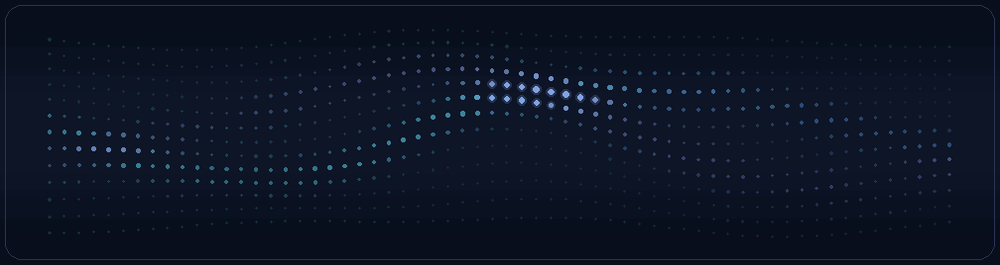

  <picture>
    <source media="(prefers-reduced-motion: reduce)" srcset="./assets/dots-still.png">
    
  </picture>

<h1 align="center">Windows tools for routing, launching, and automation</h1>

## Projects

### [SentinelProxy](/../../../SentinelProxy)

Route Windows apps through SOCKS5, HTTP, or HTTPS proxies. Set rules by app, destination, or port, then watch connections live.

### [Sentinelstrap](/../../../Sentinelstrap)

Launch Roblox with per-account settings, themes, and a server browser. A companion browser extension puts server tools on Roblox game pages.

### [SentinelTask](/../../../SentinelTask)

Record mouse and keyboard input, trim pauses in the timeline, and replay routines with one hotkey.
