<h1 align="center">Rebuilt for Windows</h1>

Three tools for routing traffic, launching Roblox, and automating repetitive input.

  <picture>
    <source media="(prefers-reduced-motion: reduce)" srcset="./assets/contribution-grid.svg">
    
  </picture>

## Sentinel projects

### [SentinelProxy](/../../../SentinelProxy)

A Proxifier alternative with live connection monitoring, rules by app, destination, or port, and proxy failover with health checks.

### [Sentinelstrap](/../../../Sentinelstrap)

A Bloxstrap and Fishstrap alternative with import support, per-account settings, live window previews, and a companion browser extension.

### [SentinelTask](/../../../SentinelTask)

A TinyTask alternative with a timeline editor, precise multi-monitor playback, and a focus guard that pauses when the target window loses focus.
